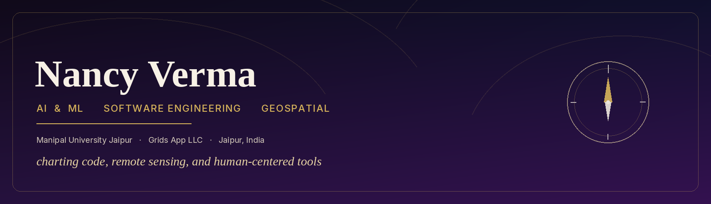
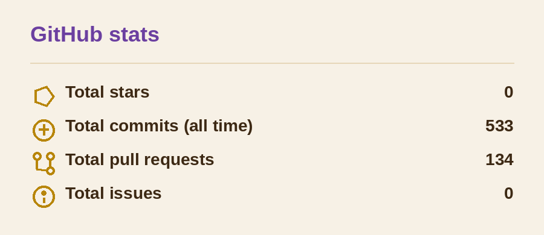

Aspiring software engineer and AI & ML student, charting a path through code, remote sensing, and human-centered tools. Google WE Scholar. I build things that turn a question into something a person can use.

  <a href="https://nancy-portfolio-new.vercel.app"><strong>Portfolio</strong></a>
  &nbsp;·&nbsp;
  <a href="https://linkedin.com/in/nancy-verma">LinkedIn</a>
  &nbsp;·&nbsp;
  <a href="https://leetcode.com/u/Nancy2005">LeetCode</a>
  &nbsp;·&nbsp;
  <a href="mailto:nancy2005nov@gmail.com">nancy2005nov@gmail.com</a>

## Skills

  

Python, C++, JavaScript, TypeScript, HTML, CSS, React, Next.js, Tailwind, Flask, TensorFlow, Keras, scikit-learn, PyTorch, Git, Docker. Also Google Earth Engine, Colab, LaTeX, and VS Code.

## Experience

- **Software engineering intern** at Grids App LLC, shipping product features.
- **B.Tech in Artificial Intelligence & Machine Learning** at Manipal University Jaipur, 2023–2027. CGPA 9.79 / 10. Dean’s List, and the Dr. TMA Pai Merit Scholarship.
- **Google WE Scholar**, 2024, selected from over 30,000 applicants for an intensive data structures and algorithms program, plus Google Immersion Week.
- **SheFi Scholar**, 2024, writing smart contracts and decentralized applications.

## Selected work

| Project | What it is |
| --- | --- |
| [FinSight](https://github.com/Nancy20052020/finsight_off) | Cash-flow prototype for a synthetic studio. A schedule-aware forecast places bills and invoices on their real dates, and on the sample books it flags a shortfall the trailing-average baseline misses. [Live](https://finsight-off.vercel.app) |
| [AutEye](https://github.com/Nancy20052020/Autism_eye) | Eye-tracking and machine learning for early autism screening, aimed at clearer signals for caregivers and clinicians. Sibling work to a patent filed in India and Germany. |
| [Grids Gold](https://github.com/Nancy20052020/GridsGold) | Responsive jewellery ERP dashboard: inventory, catalogue, and accounts in a Next.js frontend. [Live](https://grids-gold.vercel.app) |
| [TREADURE](https://github.com/Nancy20052020/Nancy_portfolio_new) | Quest-map portfolio. Next.js, Tailwind, GSAP, and Framer Motion, with a light and dark parchment theme. [Live](https://nancy-portfolio-new.vercel.app) |
| [Multi PDF Bot](https://github.com/Nancy20052020/Mutli_PDF_BOT) | Upload several PDFs, ask questions across them, and hear the answer. Flask, GPT-3.5, and ElevenLabs text-to-speech. |
| [Braille](https://github.com/Nancy20052020/Braille) | Browser tools for braille and speech, built so written text can be read by touch or heard aloud. |

### Geospatial

Remote sensing and GIS internship at India Space Academy, using Google Earth Engine.

- [Drought Sentinel](https://drive.google.com/file/d/1RZha6dBhiwGYqZHKaGM_WiZF5jK6NnmV/view) — drought analysis from satellite imagery.
- [Urban Pulse](https://drive.google.com/file/d/1TFvuLC2Rm8a2FTUSVplmug-8RdcGejW3/view) — urban maps of city signals.

## Research

- **Publication.** *Enhancing Fish Species Recognition: Deep Learning Models Evaluation*, IEEE ICDSNS 2024. Compared ResNet, VGG16, InceptionV3, and a CNN for underwater fish classification, and reported 95%+ accuracy with notes on training cost and deployment.
- **Patent.** *Autism Detection through Eye Tracking*, filed in India and Germany. An eye-tracking pipeline that surfaces early autism-related gaze signals.

Hackathons: IIC Top 17%, Prastuti finalist, IES MCRC 2nd place.

## GitHub

  <picture>
    <source media="(prefers-color-scheme: dark)" srcset="./assets/github-stats-dark.png" />
    
  </picture>
  &nbsp;&nbsp;
  <picture>
    <source media="(prefers-color-scheme: dark)" srcset="https://github-readme-stats.vercel.app/api/top-langs/?username=Nancy20052020&layout=compact&hide_border=true&langs_count=6&title_color=e6d3a3&text_color=f7f1e6&bg_color=16111c" />
    
  </picture>

Earlier experiments

- [Snake](https://github.com/Nancy20052020/snake_game) and [Pong](https://github.com/Nancy20052020/Ping_Pong), both in Python with `turtle`.
- [First portfolio](https://nancy20052020.github.io/Portfolio), the site that came before TREADURE.

